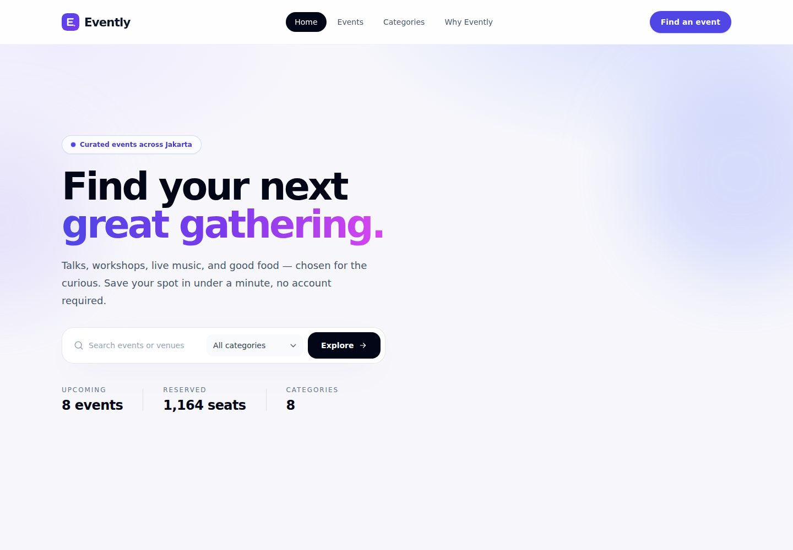
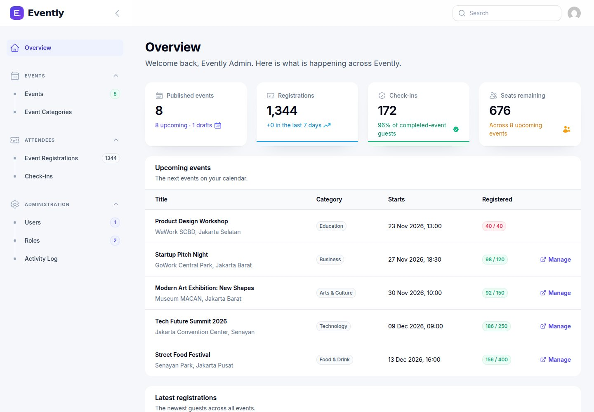
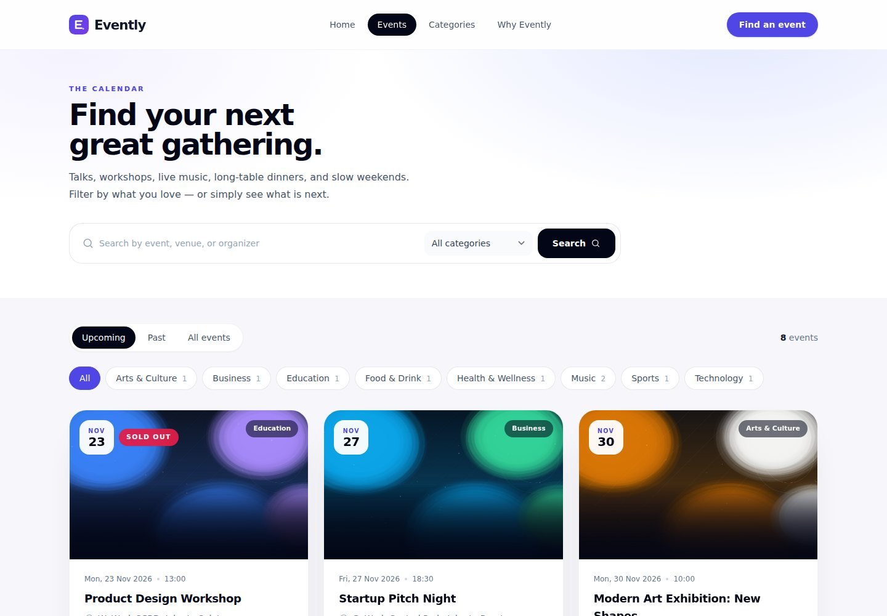
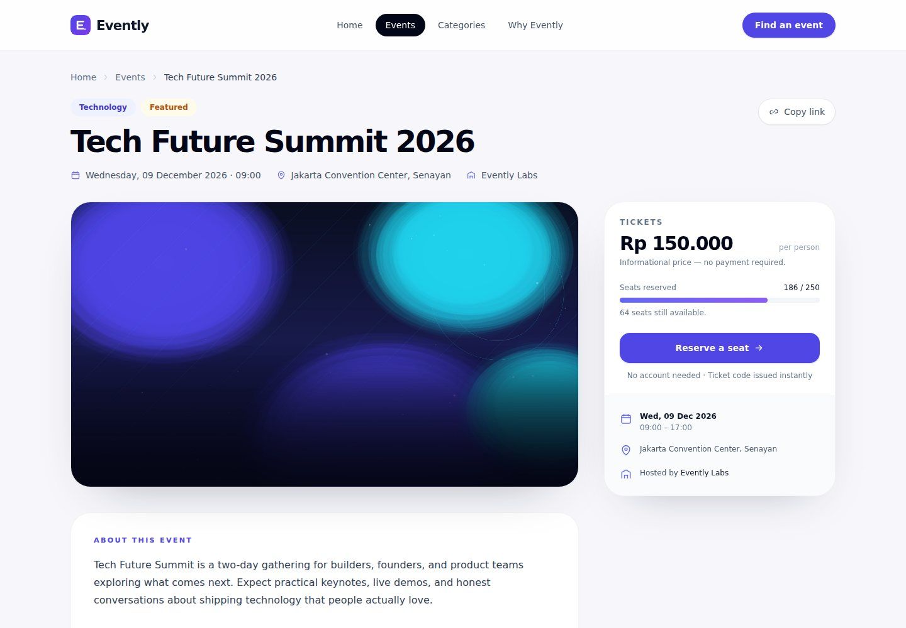
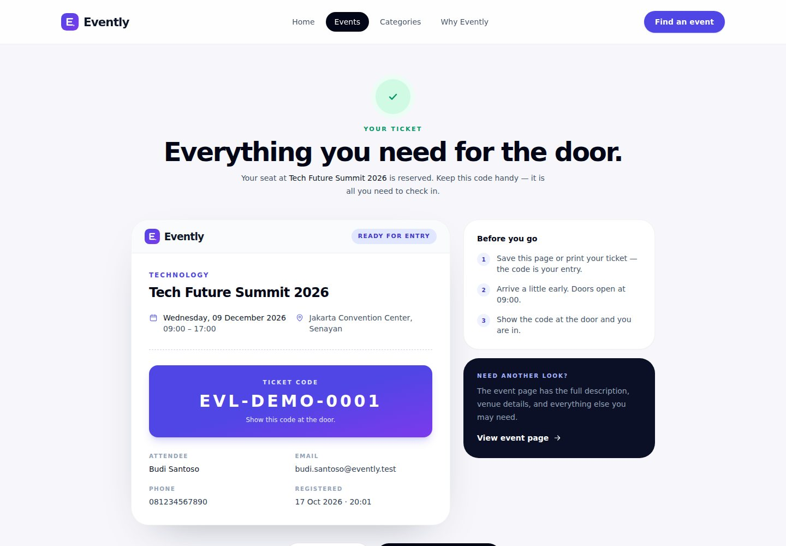
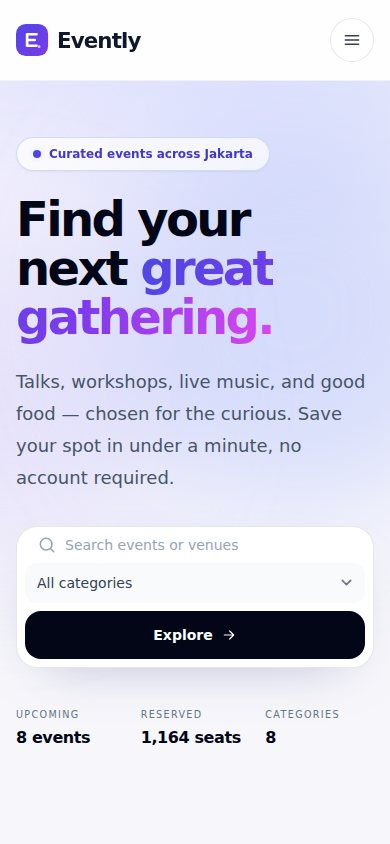

# Evently

Evently is a modern event discovery and registration platform for Jakarta. Visitors can browse curated events, reserve a free seat in under a minute, and receive a ticket code instantly — no account required. Organizers manage everything from a Filament-powered admin panel.

Built with **Laravel 12**, **Filament v3**, **Livewire**, **Tailwind CSS**, and **MariaDB**.



## Features

### Public site

- Curated home page with featured and upcoming events
- Search by event name or venue, plus category filters
- Rich event detail pages with schedule, venue, host, and seat availability
- Guest registration — no account needed
- Instant ticket page with a unique ticket code
- Responsive SaaS-style UI (desktop, tablet, and mobile)
- Sold-out, completed, and cancelled event handling

### Admin panel

- Secure Filament login with role-based access (Filament Shield)
- Overview dashboard with published events, registrations, check-ins, and remaining seats
- Event management with categories, schedules, capacity, status, and banner uploads
- Registration management with search, filters, and CSV-friendly tables
- Attendance / check-in management using ticket codes
- User management with roles and permissions
- Activity log for admin changes

<table>
  <tr>
    <td></td>
    <td></td>
  </tr>
  <tr>
    <td></td>
    <td></td>
  </tr>
</table>

<p align="center">
  
</p>

## Tech stack

| Layer | Technology |
| --- | --- |
| Backend | PHP 8.3, Laravel 12 |
| Admin | Filament v3, Livewire 3 |
| Frontend | Blade, Tailwind CSS, Vite |
| Database | MariaDB 10.11 |
| Auth & roles | Filament Shield (Spatie Permission) |
| Testing | Pest 3 |
| Runtime | Docker Compose (PHP-FPM + Nginx + MariaDB) |

## Requirements

- Docker Desktop (or Docker Engine + Compose)
- `mkcert` for trusted local HTTPS certificates (optional but recommended)

## Quick start

```bash
git clone https://github.com/VeeCaprio/evently.git
cd evently

# 1. Create a local HTTPS certificate for evently.test
mkdir -p nginx/ssl
mkcert -install
mkcert -cert-file nginx/ssl/evently.test.crt \
       -key-file nginx/ssl/evently.test.key \
       evently.test localhost 127.0.0.1

# 2. Build and start the containers
docker compose up -d --build

# 3. Prepare the application
docker compose exec -u www-data php php artisan migrate --seed
docker compose exec -u www-data php php artisan storage:link
```

The PHP entrypoint automatically copies `.env.example` to `.env`, installs Composer dependencies on first boot, and generates an application key.

Then open:

- Public site: <https://evently.test:8445>
- Admin panel: <https://evently.test:8445/admin/login>

### Domain setup

Point `evently.test` to your machine by adding this line to your hosts file:

```
127.0.0.1 evently.test
```

- **Windows:** `C:\Windows\System32\drivers\etc\hosts`
- **macOS / Linux:** `/etc/hosts`

To trust the certificate, run `mkcert -install` and (on Windows) import the mkcert root CA into **Trusted Root Certification Authorities**. Without a trusted certificate, browsers show a warning that can be bypassed via **Advanced → Proceed**.

### Alternative URLs

If you prefer not to configure a domain or certificate:

- HTTP: <http://localhost:8084>
- HTTPS (self-signed accepted manually): <https://localhost:8445>

## Demo credentials

| Role | Email | Password |
| --- | --- | --- |
| Super admin | `admin@evently.test` | `password` |
| Sample ticket | [EVL-DEMO-0001](https://evently.test:8445/tickets/EVL-DEMO-0001) | — |

These credentials are for local development only. Change them before deploying anywhere public.

## Useful commands

```bash
# Container status
docker compose ps

# Stop / start
docker compose down
docker compose up -d

# Run the test suite
docker compose exec -u www-data php php artisan test

# Format PHP code
docker compose exec -u www-data php ./vendor/bin/pint

# Clear caches after editing Blade views
docker compose exec -u www-data php php artisan optimize:clear
```

## Project structure

```
.
├── docker-compose.yml       # PHP-FPM, Nginx, MariaDB
├── db/conf.d/my.cnf         # MariaDB tuning
├── nginx/default.conf       # HTTP + HTTPS virtual host
├── php/                     # PHP image, entrypoint, FPM/INI config
├── docs/screenshots/        # README screenshots
└── src/                     # Laravel application
    ├── app/Filament/Admin/  # Filament resources, pages, widgets
    ├── app/Http/Controllers # Public site controllers
    ├── app/Models           # Event, category, registration, attendance
    ├── database/seeders/    # Demo events and registrations
    └── resources/views/     # Public Blade views
```

## Scope notes

This is **V1** of Evently:

- No online payments — ticket prices are informational only
- One ticket tier per event
- Free reservation with an instantly issued ticket code
- Check-in is handled by organizers from the admin panel

## Testing

```bash
docker compose exec -u www-data php php artisan test
```

The suite covers public pages, search and filters, registration rules, ticket lookup, and the admin panel (including guest check-in).

---

Built as a Laravel 12 + Filament v3 portfolio project.
